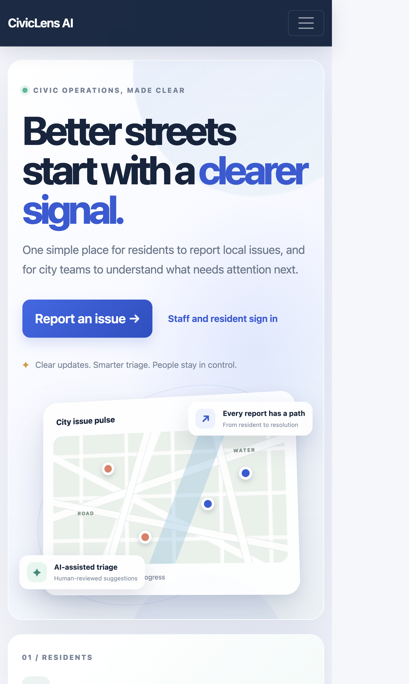
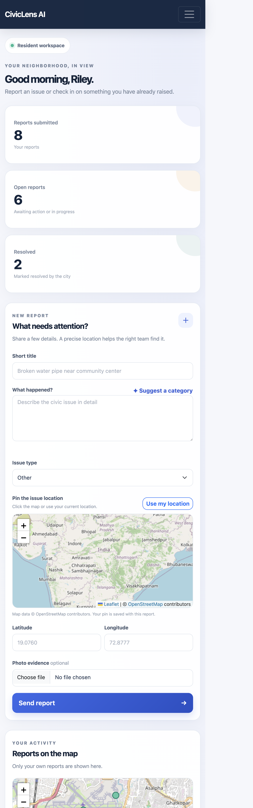
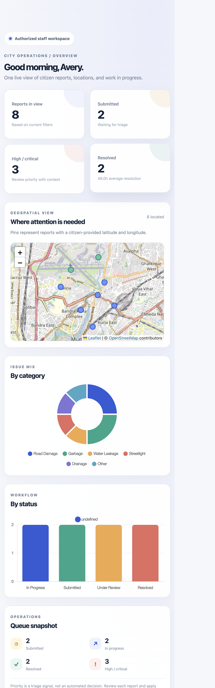
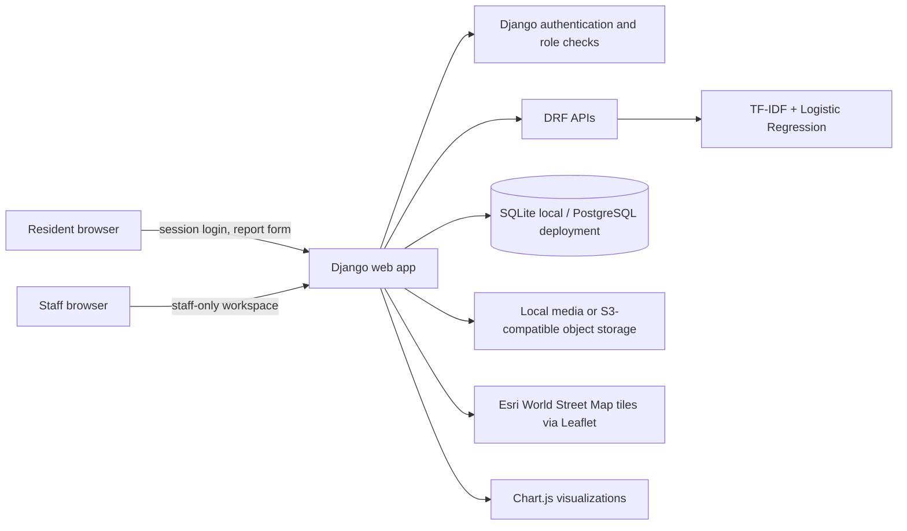

# CivicLens AI

**A civic issue reporting and operations prototype.** Residents submit local problems—including road damage, water supply, traffic signals, and public safety—with a map pin and optional photo. Authorized city staff review a separate citywide queue, update report status, and use map, chart, and AI-assisted triage views.

> **Prototype notice:** this is a portfolio/demo application, not a municipal production service. The included classifier uses a small synthetic starter dataset. Model output and rule-based priority suggestions are not validated for operational decisions; staff must review them. Do not enter sensitive personal information.

## Product tour

| Public landing | Resident workspace | Staff operations |
|---|---|---|
|  |  |  |

If screenshots are not included in a source distribution, run the app using the instructions below and capture these three pages at desktop width.

### Resident journey

1. Register a resident account or sign in.
2. Describe an issue, choose or request an AI category suggestion, pin the location, and optionally attach a photo.
3. See only your own reports, current status, the report history, and staff updates.
4. After a report is resolved, provide an optional 1–5 rating and comment.

### City staff journey

1. A staff account is provisioned by a project administrator; there is no public staff sign-up.
2. Sign in to open the staff-only operations dashboard.
3. Filter/search the citywide queue, inspect report details and map locations, assign a department and staff owner, and update status or priority.
4. Review the report event history and the prototype SLA-overdue indicators.
5. Use the staff-only AI triage page to explore category, confidence, priority rationale, and similar reports.

## Architecture



### Technology choices

- **Django + Django REST Framework:** existing API and server-rendered experience; one deployment and no separate SPA build is needed for this prototype.
- **PostgreSQL in Compose; SQLite for local setup:** local onboarding remains lightweight, while the container stack exercises a production-style relational database.
- **Leaflet + Esri World Street Map:** clickable report pins using Esri's public street basemap and its required source attribution. Tile access depends on internet connectivity and Esri's usage terms; production deployments with significant traffic should select a provider and plan that meet their needs.
- **Chart.js:** accessible, responsive category and status visualizations based on database records.
- **scikit-learn:** transparent TF-IDF and Logistic Regression baseline. The sample training corpus is synthetic, intentionally small, and not a claim of real-world accuracy.
- **Guided onboarding:** role-specific quick tours help residents and staff learn the interface. The tour works offline; it is not a conversational LLM.

## Run locally

Requirements: Python 3.12+ and pip.

```bash
python3 -m venv .venv
source .venv/bin/activate
pip install -r requirements.txt
python manage.py migrate
python manage.py createsuperuser
python manage.py runserver
```

Open [http://127.0.0.1:8000/](http://127.0.0.1:8000/). Use the account you created to sign in. A normal registration creates a resident, never a staff account. The first staff account is the Django superuser created with `createsuperuser`; additional staff should be granted the `is_staff` flag through Django admin or a controlled management process.

Local development settings have a deliberately insecure fallback secret. Set `DJANGO_SECRET_KEY` and `DJANGO_DEBUG=False` before exposing the app beyond a local development machine. Copy `.env.example` for environment variable names; Django does not read `.env` automatically outside Docker Compose.

## Run with Docker Compose

Requires Docker Engine and the Compose plugin.

```bash
cp .env.example .env
# Replace the example Django and PostgreSQL secrets in .env before use.
docker compose up --build
docker compose exec web python manage.py createsuperuser
```

Visit [http://localhost:8000/](http://localhost:8000/). Compose starts PostgreSQL with a persistent named volume, waits for its health check, then the web container applies migrations, collects static assets, and starts Gunicorn. Uploaded photos persist in a separate volume. Stop with `docker compose down`; named volumes (and their data) are retained. **Do not use `docker compose down -v` unless you intend to delete those volumes.**

For a real host, put the web service behind HTTPS, configure `DJANGO_ALLOWED_HOSTS` and `DJANGO_CSRF_TRUSTED_ORIGINS` for the deployment domain, use unique generated secrets, set `DJANGO_DEBUG=False`, and enable `DJANGO_SECURE_SSL_REDIRECT=True` only when TLS termination and forwarded-protocol headers are correctly configured. Back up PostgreSQL and uploaded media; the included Compose file is a demonstrator, not a complete managed production platform.

## Deploy to Vercel

Vercel detects this Django project through `WSGI_APPLICATION` and the Python dependencies; no custom `vercel.json` or build command is needed. It collects `STATIC_ROOT` assets during deployment. Do not use SQLite or the function filesystem for persistent app data.

1. Import `tarun-jaiin/civiclens-ai` from the Vercel dashboard and keep the project root at the repository root.
2. Add a managed PostgreSQL database through Vercel Marketplace (for example, Neon) and make its pooled PostgreSQL URL available to the project as `DATABASE_URL`.
3. Add `DJANGO_SECRET_KEY` (generate one with `python -c "import secrets; print(secrets.token_urlsafe(50))"`), `DJANGO_DEBUG=False`, and `DJANGO_SECURE_SSL_REDIRECT=True`. Add any custom domain to `DJANGO_ALLOWED_HOSTS` and its `https://` origin to `DJANGO_CSRF_TRUSTED_ORIGINS`. Vercel deployment hostnames are added automatically.
4. Deploy from Vercel. Apply migrations once against the managed database from a secure environment that can access its pooled connection URL. Vercel does not allow sensitive production variables to be pulled through `vercel env pull`; use an approved secret manager or the database provider's secure connection flow instead. Never print the URL or commit it to Git.
5. Create the first staff account using a local environment with the production database variables loaded: `python manage.py createsuperuser`. Resident registration remains public.

No object-storage service is required. Photo uploads are disabled on Vercel by default because function filesystems are ephemeral; they remain available locally. If durable report photos are needed later, configure an S3-compatible provider by setting `AWS_STORAGE_BUCKET_NAME`, `AWS_ACCESS_KEY_ID`, and `AWS_SECRET_ACCESS_KEY` together, plus `AWS_S3_ENDPOINT_URL` and `AWS_S3_REGION_NAME` when your provider requires them. Vercel Functions use an ephemeral writable `/tmp`, used for the classifier's generated model cache. Database migrations are intentionally not run during builds; run them once against the managed database before using the deployment. Review Vercel and database provider quotas or charges before sharing the app publicly.

## Deploy a portfolio demo to Render

The included [render.yaml](render.yaml) is a Render Blueprint for a free web service and PostgreSQL database. To deploy:

1. Push this repository to GitHub and sign in to Render.
2. In Render, choose **New → Blueprint**, select this GitHub repository, and apply the `render.yaml` blueprint.
3. Wait for the web service to finish its first build and migration, then open its `onrender.com` URL.
4. Open the web service's Shell in Render and run `python manage.py createsuperuser` to create the first staff account. Resident self-registration remains available on the public site.

The app accepts Render's `DATABASE_URL` as well as the separate PostgreSQL environment variables used by Docker Compose. The Blueprint uses free-tier resources for demonstration only: free services can sleep, database retention and availability are limited by the provider's current free-tier terms, and uploaded files on an ephemeral web filesystem are not durable. Do not use this deployment for real citizen data. For an operational service, choose a paid database and persistent media storage, set up backups, and review hosting, privacy, and map-tile terms.

## Roles and routes

| Route | Access | Purpose |
|---|---|---|
| `/` | Public | Product overview and clear resident/staff entry points |
| `/register/` | Public | Resident self-registration |
| `/login/` | Public | Sign in; staff are routed to operations, residents to their reports |
| `/citizen/` | Authenticated resident | Submit, map, and follow your own reports |
| `/dashboard/` | Authenticated staff (`is_staff`) | Citywide filters, charts, report map, department assignment, and SLA overview |
| `/complaint/<id>/` | Owner or staff | Report details, event history, and AI suggestion; staff can assign and update |
| `/assistant/` | Authenticated staff | AI-assisted triage and similar-report exploration |
| `/api/` | See API auth rules | Existing DRF endpoints |

Unauthorized users are redirected or denied. Residents cannot view another resident's report or use staff status-update actions.

## API endpoints

- `POST /api/auth/register/` — backwards-compatible token registration
- `POST /api/auth/login/` — DRF token login
- `GET /api/auth/profile/` — authenticated profile
- `GET, POST /api/complaints/` — authenticated; residents see/create their own reports, staff can view the citywide list
- `GET /api/complaints/<id>/` — authenticated report detail subject to ownership
- `POST /api/ai/predict/` — authenticated; residents receive matches from their own reports, staff can compare the citywide queue
- `GET /api/ai/status/` — model status and evaluation metrics when available
- `GET /api/analytics/dashboard/` — staff-only aggregate dashboard counts
- `GET /api/schema/` — machine-readable OpenAPI schema
- `GET /healthz/` — application and database readiness check

The browser UI uses Django session authentication and CSRF-protected form posts. The existing token-authenticated API remains available.

## Validation

```bash
python manage.py check
python manage.py makemigrations --check --dry-run
python manage.py test
```

GitHub Actions runs these checks for pull requests and pushes to `main`. The OpenAPI schema is available at `/api/schema/`; `/healthz/` checks application and database readiness.

## Known limitations and next steps

- Small synthetic ML corpus: collect consented, representative, labeled data and evaluate per class before claiming model quality.
- AI predictions and rule-based priority are advisory; human decisions must remain authoritative.
- Similar-report matching is lightweight text similarity, not geospatial duplicate adjudication.
- The map uses browser/network-hosted Esri World Street Map tiles; production traffic may require a contracted tile plan or self-hosting.
- No email/SMS delivery or persistent notification center. Assignment, event history, feedback, and SLA indicators are prototype workflows; SLA targets are hard-coded examples and must be replaced with approved local policy before operational use.
- Uploaded-image serving and database backups need deployment-specific storage/retention policies.
- Add automated browser tests and a formal accessibility review before presenting this as production-ready.

See [docs/SDLC_AND_DEMO.md](docs/SDLC_AND_DEMO.md) for a step-by-step development, GitHub review, Vercel release, and interview demo guide.
